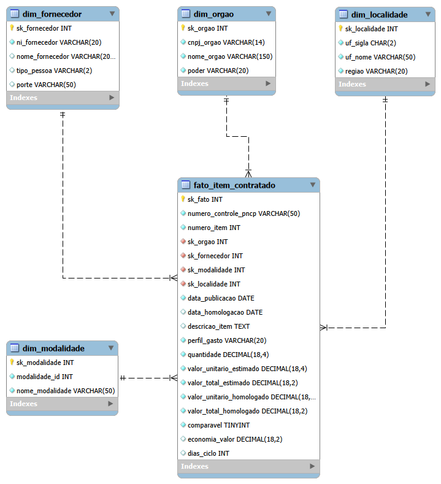
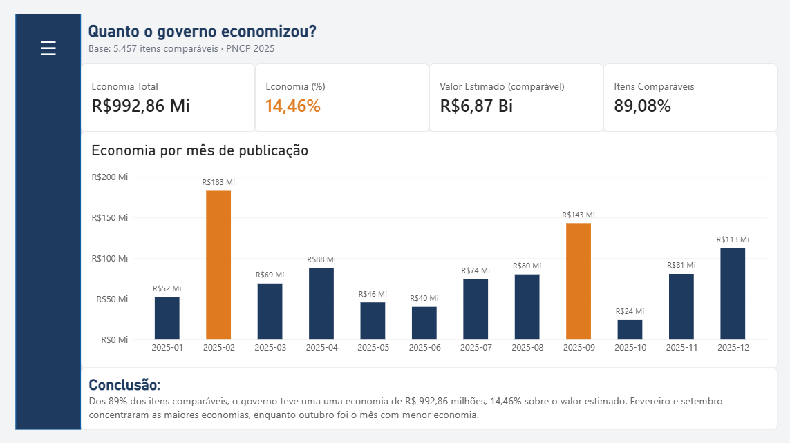
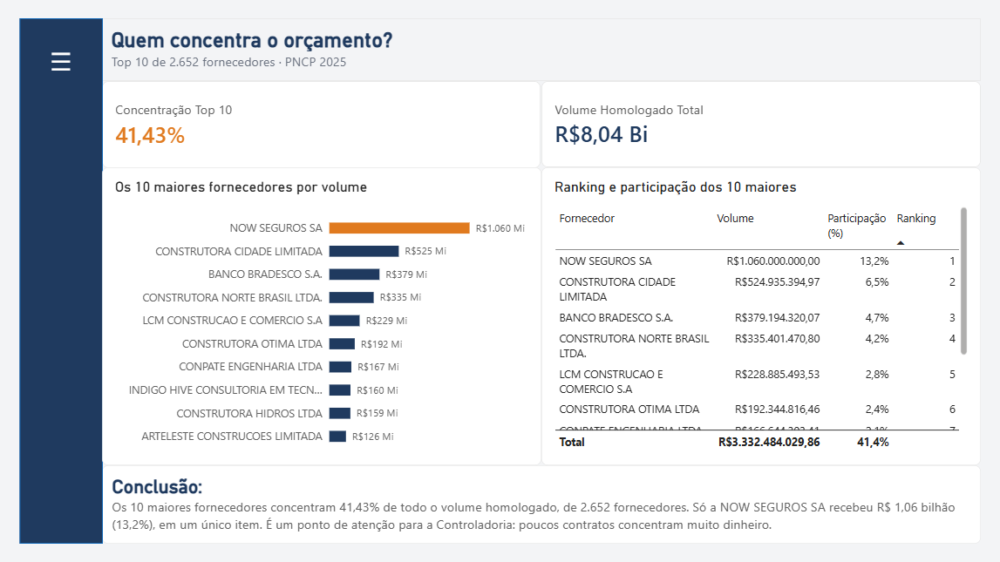
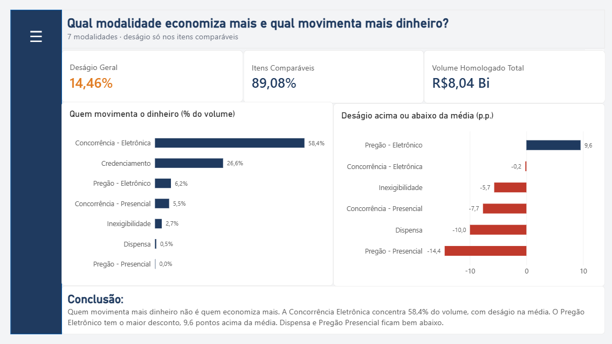
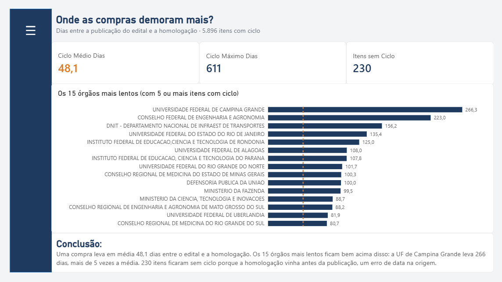
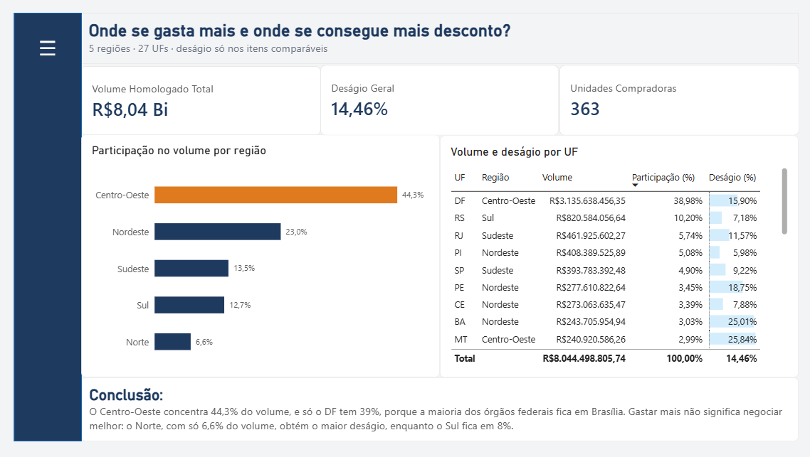
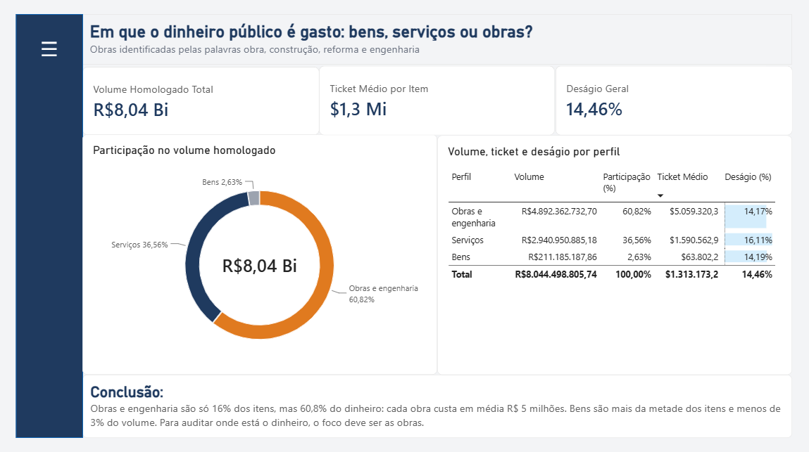
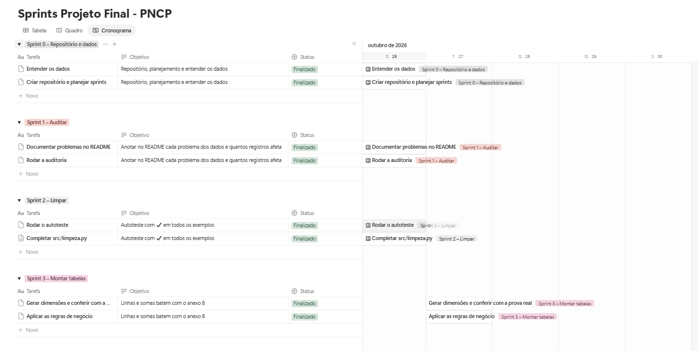
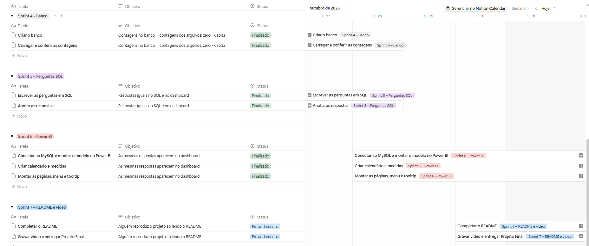

## Sobre o projeto

Esteira analítica de ponta a ponta (End-to-End) que audita e limpa os dados brutos de
compras públicas do **Portal Nacional de Contratações Públicas (PNCP)**, organiza o
resultado em um **modelo estrela** no MySQL e entrega um **dashboard executivo** no
Power BI que responde às seis perguntas da Controladoria.

---

## 1. O problema

A Controladoria identificou gargalos nas compras públicas federais: indícios de
sobrepreço, concentração de contratos em poucos fornecedores, demora entre a publicação
do edital e a homologação e baixa competição em algumas modalidades. Mas os relatórios
gerados a partir dos dados brutos não são confiáveis: os sistemas de origem não validam
nada na ponta, e os arquivos chegam com CNPJ sem o zero da esquerda, dinheiro escrito
como texto (`R$ 1.693,46`, `420,562.14`), seis formatos de data no mesmo campo,
homologações anteriores à publicação e acentos quebrados (`Aquisição`).

Este projeto resolve isso: audita e conta cada problema, limpa os dados em Python com
as regras de negócio da Controladoria, carrega um modelo estrela com integridade
garantida pelo banco e responde às perguntas em SQL e no Power BI, com os mesmos números
nos dois.

**Base:** contratações federais publicadas em 2025 (02/01 a 31/12), extraídas do PNCP
pelo professor.

| Arquivo            | Linhas | O que é                                      |
| ------------------ | -----: | --------------------------------------------- |
| `compras.csv`    |  2.042 | uma linha por contratação (o "edital")      |
| `itens.csv`      |  7.077 | uma linha por item licitado                   |
| `resultados.csv` | 15.896 | uma linha por fornecedor classificado no item |

---

## 2. Tecnologias e técnicas

| Categoria      | O que foi usado                                                                                                                                                                                  |
| -------------- | ------------------------------------------------------------------------------------------------------------------------------------------------------------------------------------------------ |
| Linguagens     | Python 3.12, SQL (MySQL 8)                                                                                                                                                                       |
| Ferramentas    | MySQL Workbench, Power BI Desktop, Git/GitHub, Notion (Sprints)                                                                                                                                 |
| Modelagem      | Modelo estrela (Star Schema): 1 fato + 4 dimensões, chaves substitutas (surrogate keys)                                                                                                         |
| Técnicas      | Auditoria de qualidade, limpeza com expressões regulares, carga em lote (`executemany`) com `rollback`, idempotência, integridade referencial (PK/FK), constraints (`CHECK`, `UNIQUE`) |
| Power BI       | Calendário em DAX, medidas explícitas com `VAR/RETURN`, `CALCULATE`, `DIVIDE`, iteradoras, indicadores (bookmarks) e dica de ferramenta (tooltip)                                        |
| Boas práticas | Credenciais em `.env` (fora do código), `.gitignore`, modularização (`config.py` / `banco.py`), autoteste das funções de limpeza                                                    |

---

## 3. Arquitetura

```
   data/raw (3 CSVs)
          │
          ▼
   auditoria.py ──────────►  reports/auditoria.md     conta os problemas
          │                                           (nao altera nada)
          ▼
   limpeza.py ────────────►  funcoes de limpeza       CNPJ, dinheiro, datas,
   (autoteste 54/54)                                  nulos, acentos
          │
          ▼
   montar_tabelas.py ─────►  data/processed           fato + 4 dimensoes
   regras de negocio                                  (CSV limpos)
          │
          ▼
   carregar.py ───────────►  MySQL                    modelo estrela com
   01_criar_banco.sql        pncp_controladoria       PK, FK, UNIQUE e CHECK
          │
          ▼
   02_perguntas.sql  ─────►  respostas em SQL
   Power BI ──────────────►  dashboard executivo      mesmos numeros do SQL
```

### Modelo dimensional



| Tabela                   | Papel                                                   | Linhas | Chave natural (UNIQUE)                     |
| ------------------------ | ------------------------------------------------------- | -----: | ------------------------------------------ |
| `fato_item_contratado` | o que foi comprado: 1 linha por item, com o vencedor    |  6.126 | `numero_controle_pncp` + `numero_item` |
| `dim_orgao`            | quem comprou (uma linha por CNPJ de unidade compradora) |    363 | `cnpj_orgao`                             |
| `dim_fornecedor`       | quem vendeu (uma linha por CNPJ/CPF)                    |  2.652 | `ni_fornecedor`                          |
| `dim_modalidade`       | como comprou                                            |      7 | `modalidade_id`                          |
| `dim_localidade`       | onde (uma linha por UF, com a região)                  |     27 | `uf_sigla`                               |
| `Calendario`           | quando (só no Power BI, criada em DAX)                 |     — | `Date`                                   |

### Constraints declaradas

| Tabela     | Constraint                                                                  | O que garante                                        |
| ---------- | --------------------------------------------------------------------------- | ---------------------------------------------------- |
| dimensões | `UNIQUE` na chave natural                                                 | o mesmo CNPJ, UF ou modalidade não entra duas vezes |
| fato       | `UNIQUE (numero_controle_pncp, numero_item)`                              | o grão: um item aparece uma vez só                 |
| fato       | `FOREIGN KEY` para as 4 dimensões                                        | nenhuma FK solta                                     |
| fato       | `CHECK (quantidade > 0)` e valores nunca negativos                        | o banco como segunda barreira (regra 4)              |
| fato       | `CHECK (comparavel = 1 OR economia_valor IS NULL)`                        | economia só nos itens comparáveis (regra 6)        |
| fato       | `CHECK (data_homologacao IS NULL OR data_homologacao >= data_publicacao)` | nenhuma homologação antes do edital (regra 7)      |
| fato       | `CHECK (perfil_gasto IN (...))` e `CHECK (dias_ciclo >= 0)`             | só as 3 classes de perfil; ciclo nunca negativo     |

---

## 4. Estrutura do repositório

```
projeto/
├── data/
│   ├── raw/                 # 3 CSVs brutos do PNCP (fornecidos pelo professor)
│   └── processed/           # fato + dimensões limpas (gerado, ignorado pelo Git)
├── src/
│   ├── config.py            # caminhos + leitura do .env
│   ├── banco.py             # conexão e funções utilitárias do MySQL
│   ├── auditoria.py         # Sprint 1: conta os problemas dos dados brutos
│   ├── limpeza.py           # funções de limpeza + autoteste
│   ├── montar_tabelas.py    # regras de negócio → fato e dimensões
│   └── carregar.py          # carga em lote no MySQL (com rollback) + conferência
├── sql/
│   ├── 00_conferencia.sql   # confere o banco com a prova real (anexo 8)
│   ├── 01_criar_banco.sql   # banco + 5 tabelas (PK, FK, UNIQUE, CHECK)
│   └── 02_perguntas.sql     # as 6 perguntas de negócio
├── powerbi/
│   └── pncp_controladoria.pbix   # dashboard (capa + 6 páginas + tooltip)
├── docs/
│   ├── powerbi_dax.md       # Calendário e medidas DAX
│   └── img/                 # capa, modelo estrela, sprints e prints das páginas
├── reports/
│   └── auditoria.md         # resultado da auditoria
├── .env.example             # modelo de credenciais
├── .gitignore
├── requirements.txt
└── README.md
```

---

## 5. Como executar

### Pré-requisitos

- Python 3.10 ou superior
- MySQL 8.0 ou superior (o `CHECK` só é validado a partir do 8.0.16)
- Power BI Desktop com o driver MySQL Connector/NET 8.x

### Passo a passo

```bash
# 1. Clonar e instalar as dependências
git clone https://github.com/talitaasdzulinski/pncp-controladoria
pip install -r requirements.txt

# 2. Configurar as credenciais
copy .env.example .env
# edite o .env com o usuário e a senha do seu MySQL
```

```bash
# 3. Rodar o pipeline, na ordem (sempre da pasta raiz do projeto)
python -m src.auditoria        # conta os problemas → reports/auditoria.md
python -m src.limpeza          # autoteste das funções: 54 de 54 ✔
python -m src.montar_tabelas   # regras de negócio → data/processed (compara com a prova real)
python -m src.carregar         # cria o banco, carrega e confere as contagens
```

```sql
-- 4. Conferir e responder (no MySQL Workbench)
--    sql/00_conferencia.sql  -> tudo deve bater com a coluna "esperado"
--    sql/02_perguntas.sql    -> as seis respostas
```

5. Abrir `powerbi/pncp_controladoria.pbix` → Página Inicial → **Atualizar**.

O `carregar.py` executa o `01_criar_banco.sql` sozinho, e o script recria as tabelas a
cada execução: o pipeline é **idempotente** e pode ser rodado quantas vezes for preciso
sem duplicar registros.

---

## 6. Diagnóstico da origem

Números gerados por `python -m src.auditoria` (relatório completo em
`reports/auditoria.md`).

| O que foi medido                                                             |               Valor |
| ---------------------------------------------------------------------------- | ------------------: |
| `numero_controle_pncp` repetido em `compras.csv`                         |                   0 |
| Itens com mais de um resultado (Registro de Preços)                         |                 466 |
| `cnpj_orgao` com máscara / sem o zero da esquerda                         |            176 / 77 |
| Documento de fornecedor PJ com máscara / sem o zero                         |         1.239 / 194 |
| Documento de fornecedor PF com máscara / sem o zero                         |           392 / 159 |
| Fornecedores distintos antes → depois de limpar o documento                 |    11.418 → 10.299 |
| Valores e quantidades com `R$` (por coluna)                                |       1.148 a 2.650 |
| Valores e quantidades com vírgula decimal (por coluna)                      |       1.447 a 3.219 |
| `data_publicacao` / `data_resultado` fora do padrão AAAA-MM-DD          |         723 / 5.595 |
| Resultados com homologação **anterior** à publicação              |                 234 |
| Nulos disfarçados em `porte` / `modo_disputa` / `criterio_julgamento` | 4.836 / 960 / 1.883 |
| `categoria_item` = "Não se aplica" (a coluna inteira)                     |               7.077 |
| Acento quebrado em `descricao` / `nome_unidade` / `objeto_compra`      |     223 / 176 / 173 |
| Órgãos (CNPJ) com o nome escrito de mais de um jeito                       |                  67 |

O que esse diagnóstico já mostra antes de tratar qualquer coisa:

- **O mesmo fornecedor aparecia como vários.** Eram 11.418 documentos de fornecedor,
  mas, depois de tirar a máscara e devolver os zeros, sobraram 10.299: 1.119 eram o
  mesmo CNPJ/CPF escrito de outro jeito. Sem essa limpeza, o ranking da P2 dividiria o
  volume de um fornecedor em várias linhas.
- **O dinheiro vinha em formatos misturados.** No mesmo campo havia `1.234,56` e
  `1,234.56`. Não dava para reaproveitar o truque do projeto anterior (apagar todos os
  pontos): `746.815` viraria 746 mil, e o volume homologado passaria de R$ 8 bi para
  cerca de R$ 31 bi.
- **Algumas colunas não servem para análise.** A `categoria_item` vem toda como "Não se
  aplica", então o perfil do gasto (P6) foi classificado pelo `material_ou_servico` e
  por palavras-chave na descrição.

---

## 7. Decisões de projeto

| Decisão                   | Escolha                                                                                                                                                                              | Motivo                                                                                                                                                                            |
| -------------------------- | ------------------------------------------------------------------------------------------------------------------------------------------------------------------------------------ | --------------------------------------------------------------------------------------------------------------------------------------------------------------------------------- |
| Leitura dos CSVs           | Tudo como texto (`dtype=str`)                                                                                                                                                      | O pandas tiraria o zero da esquerda do CNPJ e transformaria "N/A" em NaN sozinho.                                                                                                 |
| Nulos disfarçados         | `N/A`, `-`, `NULL`, `SEM INFORMAÇÃO`... → `None`; o `"0"` só é nulo em campo de **texto**                                                                     | Em quantidade e valor, 0 é um número de verdade.                                                                                                                                |
| Separador decimal          | Ponto ou vírgula **sozinho** é decimal; repetido é milhar; com os dois, o último é o decimal                                                                              | Regra da base: `0,754` e `746.815` são decimais.                                                                                                                             |
| Vencedor do item (regra 2) | Descarta os cancelados **primeiro**; depois fica com a menor `ordem_classificacao_srp` (vazio = 1); empate pelo menor `sequencial_resultado`                               | Se o 1º colocado foi cancelado, o 2º assume. Na ordem inversa, cerca de 60 itens perderiam o resultado.                                                                         |
| Itens sem resultado        | Ficam fora da fato (852) e **não** contam como rejeitados                                                                                                                     | Sem um vencedor não há o que comparar.                                                                                                                                          |
| Itens rejeitados (99)      | Quantidade ≤ 0; unitário estimado ou homologado ausente/≤ 0; orçamento sigiloso; estimado total < R$ 1; homologado > 1.000× o estimado; total > R$ 1 trilhão                 | Dados impossíveis distorceriam a economia. O banco repete a regra com `CHECK`.                                                                                                 |
| Quantidade dos totais      | A homologada (ou a do item, se vier vazia/0), **nos dois lados**                                                                                                               | Estimado e homologado precisam da mesma quantidade para a comparação ser justa.                                                                                                 |
| Item comparável (regra 6) | Não é Credenciamento **e** homologado ÷ estimado entre 0,1 e 10                                                                                                             | No Credenciamento o estimado é um teto global; razões fora da faixa indicam erro de unidade.                                                                                    |
| Economia                   | `estimado − homologado` só nos comparáveis; **vazio (NULL)** nos demais; % = soma ÷ soma                                                                                 | O kit gravava 0 nos não comparáveis; segui a seção 4.3 do enunciado (vazio), para uma média futura não ser puxada para zero. As somas não mudam.                           |
| Cronologia (regra 7)       | Homologação antes da publicação → data e ciclo ficam vazios, mas o item continua na fato                                                                                        | O item existe e tem valor; só a data é impossível. Resultado: 230 itens sem ciclo.                                                                                             |
| Perfil do gasto (regra 8)  | Palavras inteiras (`\b`) na descrição + objeto: `OBRA(S)`, `CONSTRUÇÃO`, `REFORMA`, `ENGENHARIA` → Obras e engenharia; senão Material → Bens, Serviço → Serviços | Sem o `\b`, "cobrança" e "dobradiça" virariam obra.                                                                                                                           |
| Órgão (regra 10)         | Uma linha por CNPJ na dimensão; nas perguntas, agrupa pelo **nome** padronizado                                                                                               | O mesmo órgão tem várias unidades (CNPJ): o DNIT tem 12.                                                                                                                       |
| Linha −1 "Não Informado" | **Não** foi criada                                                                                                                                                            | O enunciado só a exige quando sobra FK sem destino, e nesta base toda linha da fato encontra a sua dimensão. As `sk` são `INT` com sinal, então dá para criar no futuro. |
| Carga                      | Em lote (`executemany`), com `commit` só no final e `rollback` se o banco recusar alguma linha                                                                                | Nunca fica uma carga pela metade no banco.                                                                                                                                        |
| Idempotência              | O `01_criar_banco.sql` derruba e recria as tabelas (fato primeiro, por causa da FK)                                                                                                | Rodar o pipeline de novo não duplica nada.                                                                                                                                       |

**Discordâncias e observações sobre as regras** (o enunciado pede para anotar aqui):

- "Itens com sobrepreço" (27) só faz sentido na base comparável: na fato inteira
  seriam 60, mas 33 deles são Credenciamento ou têm razão fora de 0,1–10, onde o
  estimado não serve de referência.
- O kit gravava economia 0 nos itens não comparáveis; gravei vazio (NULL), como pede a
  seção 4.3. Zero diria "não economizou", e vazio diz "não se aplica".

---

## 8. Conferência com a prova real (anexo 8)

| Conferência                               |                                                   Esperado |                             Obtido |
| ------------------------------------------ | ---------------------------------------------------------: | ---------------------------------: |
| Itens com resultado / rejeitados / na fato |                                         6.225 / 99 / 6.126 |                 6.225 / 99 / 6.126 |
| Contratações · Fornecedores · Unidades |                                      1.962 · 2.652 · 363 |              1.962 · 2.652 · 363 |
| Volume homologado                          | R$ 8.044.498.805,74 |                R$ 8.044.498.805,74 |                                    |
| Estimado comparável / itens comparáveis  |                                R$ 6.867.663.469,91 / 5.457 |                               idem |
| Economia                                   |                                 R$ 992.861.686,95 (14,46%) |                               idem |
| Itens com sobrepreço                      |                                                         27 |                                 27 |
| Ciclo médio / máximo / itens sem ciclo   |                                           48,1 / 611 / 230 |                   48,1 / 611 / 230 |
| Perfil (% do volume)                       |                   Obras 60,8 · Serviços 36,6 · Bens 2,6 | idem (967 · 1.849 · 3.310 itens) |

---

## 9. Perguntas de negócio respondidas

Todas em `sql/02_perguntas.sql` e no dashboard, com os mesmos números.

1. Qual é o percentual e o valor economizado pelo governo?
2. Quem são os maiores fornecedores e quanto do orçamento está concentrado neles?
3. Quais modalidades trazem maior deságio e quais concentram o maior volume?
4. Qual a duração média entre o edital e a homologação, por órgão?
5. Quais estados e regiões concentram as maiores despesas e os melhores descontos?
6. Como os recursos se distribuem entre bens, serviços e obras?

---

## 10. Dashboard e conclusões

O painel abre numa capa com os números principais e um atalho para cada pergunta. Cada
página segue a mesma estrutura: **a pergunta → os números → a conclusão**. A navegação
é feita por um menu retrátil (botão ☰, com indicadores) e a página de Modalidades tem uma
dica de ferramenta personalizada.


### P1 — Quanto o governo economizou?



O governo economizou **R$ 992,86 milhões, 14,46%** sobre o valor estimado. A conta usa
89% dos itens: o restante (Credenciamento e valores fora de proporção) não permite
comparar. Fevereiro e setembro concentraram as maiores economias.

### P2 — Quem concentra o orçamento? É um risco?



Os 10 maiores fornecedores, de 2.652, concentram **41,43%** de todo o volume homologado.
Só a NOW SEGUROS SA recebeu **R$ 1,06 bilhão (13,2%)**, em um único item. É um ponto de
atenção: poucos contratos concentram muito dinheiro.

### P3 — Qual modalidade economiza mais e qual movimenta mais dinheiro?



Quem movimenta mais dinheiro não é quem economiza mais. A Concorrência Eletrônica
concentra **58,4%** do volume, com deságio na média; o **Pregão Eletrônico** tem o maior
desconto, **9,6 pontos acima da média**. Dispensa e Pregão Presencial ficam bem abaixo.
O Credenciamento não tem deságio, porque nenhum item dele é comparável.

### P4 — Onde as compras demoram mais?



Uma compra leva em média **48,1 dias** entre o edital e a homologação. Os 15 órgãos mais
lentos (com 5 ou mais itens com ciclo) ficam bem acima disso: a Universidade Federal de
Campina Grande leva **266 dias**, mais de 5 vezes a média. 230 itens ficaram sem ciclo
porque a homologação vinha antes da publicação, um erro de data na origem.

### P5 — Onde se gasta mais e onde se consegue mais desconto?



O **Centro-Oeste concentra 44,3%** do volume, e só o DF tem 39%, porque a maioria dos
órgãos federais fica em Brasília. O maior desconto é do **Norte (21,4%)**, e o menor, do
Sul (8,0%): gastar mais não significa negociar melhor.

### P6 — Em que o dinheiro público é gasto?



**Obras e engenharia são só 16% dos itens, mas 60,8% do dinheiro**: cada obra custa em
média R$ 5 milhões. Bens são mais da metade dos itens e menos de 3% do volume. Para
auditar onde está o dinheiro, o foco deve ser as obras.

---

## 11. Planejamento em Sprints

Dividi o projeto em  8 Sprints, cada uma com um objetivo e um critério de "pronto" conferível na prova real. O planejamento ficou no Notion, com um quadro para o dia a dia e um cronograma.




---

## 12. Melhorias futuras

- **Extração direta da API do PNCP** com carga incremental por mês, em vez de recarregar a base inteira.
- **Dicionário de sinônimos de órgãos** (sigla × nome por extenso), além de padronizar caixa e espaços.
- **Classificação do perfil pelo catálogo oficial** (CATMAT/CATSER) quando o código vier preenchido.
- **Índices** nas FKs da fato, para acelerar as consultas com `JOIN`.

---

## Vídeo

[Review da Sprint — apresentação do projeto](COLE-AQUI-O-LINK-DO-DRIVE)

---

## Autora

**Talita Aparecida Silva Dzulinski** | Turma 2 | Módulo 2 — Análise de Dados com Python
